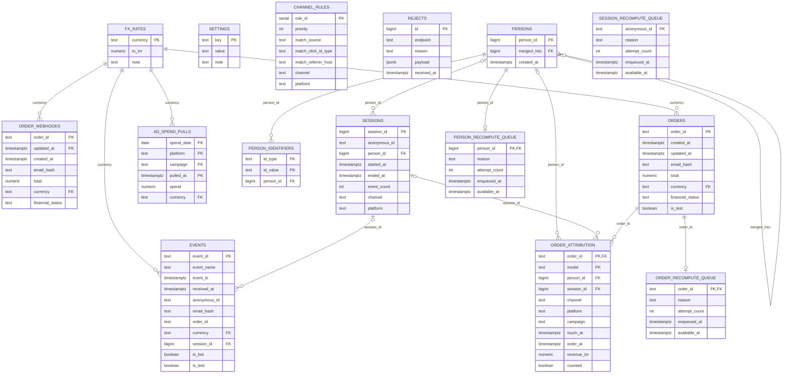

# AttributionIQ database ER diagram

This diagram covers the persisted tables and their declared foreign-key
relationships. It is maintained separately from the project README. The
migrations in `src/main/resources/db/migration` are the source of truth.

## Relationship notes

- `EVENTS.anonymous_id` and `SESSIONS.anonymous_id` are related by application
  logic, not by a foreign key. Anonymous IDs are also represented in
  `PERSON_IDENTIFIERS` with `id_type = 'anon'`.
- `email_hash` on events and orders is a matching attribute, not a foreign key.
  The identity relationship is represented by `PERSON_IDENTIFIERS` with
  `id_type = 'email'`.
- `ORDER_WEBHOOKS.order_id` has no declared foreign key to `ORDERS`; it is an
  append-only source history, while `ORDERS` stores the latest accepted state.
- `SESSION_RECOMPUTE_QUEUE.anonymous_id` intentionally has no foreign key.
- `CHANNEL_RULES` is consulted by the `classify_touch(...)` function. Channel
  values on sessions, attribution rows, and spend reports are derived strings,
  not normalized channel-table foreign keys.
- `ad_spend_current` is a view over the latest row in `AD_SPEND_PULLS` for each
  spend date/platform/campaign. `channel_daily(...)` is a reporting function
  combining current spend with attributed revenue; neither is a base table.
- `SETTINGS` stores policies such as the session gap and attribution window.
  `REJECTS` stores rejected-request metadata and has no relationship to accepted
  facts.

## Main migration objects

- `V1__initial_schema.sql`: bootstrap check table, removed by V3.
- `V2__init_attr_schema.sql`: reference, ingest, identity, session, attribution,
  queue, view, function, and reporting schema.
- `V3__remove_unused_schema_check.sql`: removes the bootstrap-only table.
- `V4__durable_recompute_jobs.sql`: retry fields/indexes and order recompute queue.
